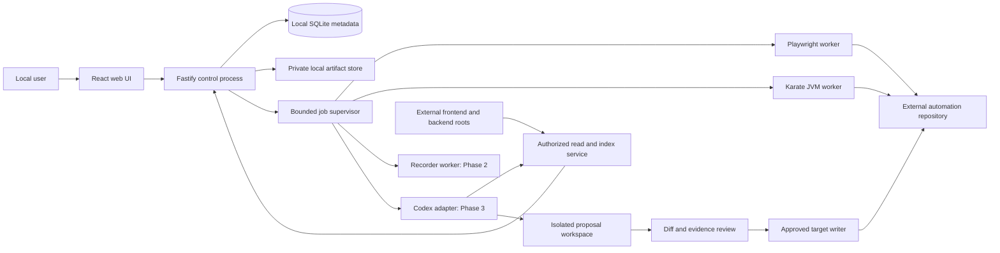

# Architecture baseline

Date: 2026-11-05. Status: accepted Phase 0 planning baseline; runtime implementation is gated by phase approval. Statements here describe intended behavior, not working software.

Phase 1 implementation amendments and exact toolchain are recorded in [ADR 0009](decisions/0009-phase-1-runtime-and-boundaries.md) and the [Phase 1 report](phase-1-report.md). The complete-product design below includes future, unapproved modules. Transport schemas currently live beside their owning modules; no empty contracts package was added.

## 1. Operating model

Build a single-user application on one trusted workstation. A local browser uses a same-origin web application served by a Fastify control process bound to loopback. The backend owns authorization, SQLite writes, migrations, job state, and artifact references. Browser recording, test execution, indexing, and agent work run outside the HTTP request loop in supervised workers introduced only when their phase needs them.



Process boundaries isolate failures and resource consumption. They do **not** stop test code from accessing the host. Security restrictions and execution trust are specified in [security.md](security.md).

## 2. Technology evaluation

| Concern       | Baseline                                                                                                           | Alternatives and tradeoff                                                                                                                                                                          |
| ------------- | ------------------------------------------------------------------------------------------------------------------ | -------------------------------------------------------------------------------------------------------------------------------------------------------------------------------------------------- |
| Web           | React + TypeScript + Vite                                                                                          | Next.js adds an unnecessary second server/rendering model for this workstation tool. Electron/Tauri adds packaging and bridge privileges; defer until browser limitations justify it.              |
| Backend       | Fastify, JSON Schema validation, typed contracts                                                                   | Express needs more conventions for schema validation; NestJS introduces a broader framework before module boundaries are proven. Fastify plugins provide local encapsulation.                      |
| Runtime/build | Node.js 24 LTS + pnpm workspaces; ordinary scripts                                                                 | Node 26 is also LTS at research time, but 24 is the conservative starting compatibility target. No Nx/Turborepo until measured build cost warrants it.                                             |
| Metadata      | SQLite with explicit SQL migrations and a small typed data-access layer                                            | PostgreSQL adds a service and installation burden. A graph database is premature. ORM convenience is optional; avoid hiding SQL or migration behavior behind a large framework.                    |
| SQLite driver | Prefer a maintained native driver with supported Node prebuilds; decide the exact package in P1 compatibility work | `better-sqlite3` is a candidate; native packaging and embedded SQLite version must be tested. Large queries go off the request path. Do not select experimental APIs solely to avoid a dependency. |
| Artifacts     | Local filesystem, SQLite manifests and checksums                                                                   | Large traces/audio in database rows amplify backups and locking; object storage is unnecessary locally.                                                                                            |
| UI runner     | Playwright Test + Playwright-BDD + TypeScript                                                                      | Cucumber-JS would require another lifecycle/fixture bridge. Keep native Playwright reports and traces.                                                                                             |
| API runner    | Karate + Java 21 + Gradle wrapper                                                                                  | Maven is viable for imported projects. New starters use Gradle as requested; do not rewrite imported build systems.                                                                                |
| Agents        | Provider-neutral task port, Codex app-server over stdio as first adapter                                           | SDK fits simpler jobs; app-server is preferred for interactive approvals and progress. An HTTP agent service is unnecessary for local MVP.                                                         |
| Progress      | REST commands + SSE events with replay cursor                                                                      | WebSockets are unnecessary for initial status streams. Audio uploads use bounded HTTP chunks rather than a new streaming transport.                                                                |
| Search        | Structured SQLite capabilities, indexed symbols and edges; later FTS if useful                                     | No embedding service or vector database in MVP. Add semantic search only after lexical retrieval misses are measured.                                                                              |

Version policy: research validates a direction, not a lockfile. P1 must pin the full compatible toolchain and test both runner integrations. SQLite WAL is permitted only with a verified fixed engine (3.51.3+ or a documented fixed backport); the actual embedded engine must be queried. The primary sources and version caveats are in [sources.md](sources.md).

## 3. Repository and process ownership

Proposed layout, **not created in Phase 0**:

```text
platform/
  apps/web/                 React UI
  apps/server/              composition root, HTTP, lifecycle, modules
  apps/demo/                real promotion UI and API, separate process
  packages/contracts/      transport/event schemas; no framework internals
  packages/domain/         canonical scenario and identity logic
  packages/execution/      supervisor and runner adapters
  packages/workspace/      roots, permissions and file gateway
  packages/storage/        migrations and data access
  packages/recording/      added in Phase 2
  packages/intelligence/   added incrementally from Phase 3
  packages/agents/         added in Phase 3
  templates/automation/    plain starter files, never a nested checkout
  docs/                    rationale, phase evidence, curated knowledge
```

Do not create packages until they hold current-phase behavior. A module can begin inside `apps/server` and move to a package when sharing warrants it. The frontend calls contracts rather than storage or runner internals. Domain code has no Fastify, Playwright, Karate, database, or provider dependency. Avoid a generic plugin loader and runtime dependency injection framework in MVP.

Each configured workspace owns source-root registrations, one active automation target (additional targets supported by the data model), environment references, and private state. A managed target is an external directory or Git checkout, not a child of the platform or a context source. Imports remain independently executable and are not silently converted to the starter layout.

```text
functional-tests/           separate user-owned Git root
  contracts/features/      canonical business .feature files
  contracts/manifest.json  stable IDs, target bindings, revisions
  ui/                      own package.json/lock, bdd config, pages, components,
                           steps, fixtures, builders, environment config
  api/                     Gradle wrapper, Karate features, schemas, auth,
                           helpers, data builders, environment config
  docs/                    target-specific curated knowledge
  .agents/skills/           only approved, applicable target skills
```

The UI starter reads canonical features through Playwright-BDD configuration; generated Playwright files are disposable build output. Karate features are distinct technical artifacts linked by the manifest. The platform's own code and libraries are not required to execute either target from its CLI. The starter manifest is a portable schema, not a runtime dependency.

Runtime database, captures, auth state, credentials, proposals, and reports live in a private platform data directory outside every repository, with an explicit override and OS-appropriate default. User-specific paths and environment secrets are not committed. Backups coordinate SQLite and artifact manifests; active runs are not portable snapshots.

## 4. Domain and module boundaries

| Module             | Owns                                                       | Key rule                                                 | First implementation        |
| ------------------ | ---------------------------------------------------------- | -------------------------------------------------------- | --------------------------- |
| Workspace          | roots, target registration, grants, environment references | ID-based access; no arbitrary path API                   | P1                          |
| Scenarios          | canonical Gherkin, revisions, examples, target bindings    | one authoritative contract; approved revisions immutable | P1 manual; P3 proposals     |
| Execution          | selections, jobs, attempts, runner normalization           | preserve native outcomes and capability limits           | P1                          |
| Reporting          | normalized read models, artifact access                    | never infer success from missing reports                 | P1                          |
| Recording          | capture sessions, evidence, timeline, transcript           | observations are not requirements                        | P2                          |
| Intelligence       | incremental source/capability index                        | query relevant versioned context only                    | basic reuse P3; graph P5    |
| Agents             | provider sessions, plans, proposals, review                | cannot self-authorize writes                             | P3                          |
| Knowledge & Skills | discoveries, proposals, evaluations, activation            | provenance and rollback required                         | curated P0; evolution P6    |
| Autohealth         | deterministic findings, policies, schedules                | findings do not authorize repairs                        | basic readiness P1; full P6 |

The logical [data model](domain-model.md) specifies identities and first-needed phases. No future tables or placeholder services are required in P1.

## 5. Multi-repository intelligence

Settings register a display name, canonical absolute root (private), source kind, detected languages/frameworks, Git metadata if present, optional preferred ref, read-only grant, indexing toggle, and include/exclude patterns. A non-Git directory remains valid. A preferred ref labels the intended context; it never triggers checkout in the user's directory. Read an object snapshot without changing the working tree or explicitly index the current dirty tree with per-file hashes. Show mismatches rather than pretending a dirty tree equals `HEAD`.

Indexing is on-demand and opt-in per source. Exclude secrets, dependency/build directories, generated files, binaries and oversized files by default. Git ignore rules are a useful baseline, not a security policy. Include rules cannot bypass secret exclusions or root grants. Do not execute package scripts, app configs or imported agent instructions while detecting repositories.

Discovery starts with manifests, filenames, OpenAPI contracts and supported TypeScript/JavaScript syntax. Routes, roles/labels, test IDs, forms, tests and models are frontend capabilities; endpoints, auth, schemas, services and setup helpers are backend capabilities. Dynamic routes and runtime-generated labels may be unresolved. Each result carries extractor version, repository/file revision, location, content hash, evidence and confidence. Detection is explicitly incomplete for unsupported languages/frameworks; add extractors as approved needs emerge, not a universal parser promise.

Cache key: `(source ID, logical revision or dirty-tree fingerprint, file hash, extractor version, config hash)`. A file watcher marks candidates dirty; it is not authoritative. Rescan after restarts and apply deletions/renames transactionally. Unchanged files reuse extraction; branch changes and config changes invalidate affected entries. Query structured relationships first, then bounded excerpts. Context responses include provenance, freshness and truncation. Stale entries cannot justify applying a change.

## 6. Functional contract and framework execution

Gherkin text in the managed target is authoritative after an authorized save. SQLite stores drafts, parsed projections and execution snapshots; it is not a competing editable source. External edits trigger hash-conflict checks and reparsing. Preserve comments, tags, descriptions, language, Backgrounds, Rule structure, docstrings and tables. Do not round-trip through an AST printer that silently discards formatting.

Use the official Gherkin grammar/parser. Persist stable IDs in portable manifest metadata, with an optional explicit tag when needed for selection. Renames and line moves do not change scenario identity. Example row identity is distinct from values so duplicate datasets remain distinguishable. An execution stores the exact contract revision and values; old results never follow a changed row silently.

A framework adapter advertises supported selections (scenario, row, feature, tags, suite), validates prerequisites, compiles a typed selection into fixed runner arguments, starts execution, streams events, cancels, and collects results. Unsupported row selection is a visible capability error; never broaden it to an entire feature without the user's choice. P1 guarantees scenario/feature/tag/suite selection; row selection remains capability-gated until verified against the pinned runners.

Playwright uses thin business steps calling Pages/Page Components and fixtures. Karate uses native feature composition and technical API assertions. Both link back to the same business identity where justified. UI checks include visibility and rendered text; API checks cover response fields and protocol semantics. Store assertion coverage explicitly. A successful API run must not mark UI coverage as passed. Hybrid is a separate execution plan that retains each segment's evidence; API setup alone does not make an otherwise UI scenario a fully cross-framework contract.

The illustrative field `discount = 50€` is ambiguous for free shipping: it represents the demo's displayed amount, while `thresholdMinor` explicitly represents minimum order value. Do not interpret it as a €50 reduction, a percentage discount, or proof that a real order qualifies. Guest country/language/brand are explicit demo context inputs, not inferred geolocation or authentication claims.

See [ADR 0004](decisions/0004-functional-contract-and-execution.md) and [quality standards](quality-standards.md) for runner conventions.

## 7. Jobs, results and failure handling

Create a run and immutable selection snapshot in a short database transaction; enqueue a persisted job. One control process leases jobs. Begin with a global worker limit of one run, configurable after measurement, and one writer lease per target. UI remains responsive during a JVM/browser run. Workers send bounded, schema-validated events; only the backend writes SQLite. Long logs become artifacts with truncated previews.

Job states: `QUEUED → RUNNING → SUCCEEDED | FAILED | CANCELLED | INTERRUPTED`; cancellation first sets `CANCEL_REQUESTED`. A run retains individual test statuses (`PASSED`, `FAILED`, `SKIPPED`, `TIMED_OUT`, `CANCELLED`, `UNKNOWN`) and infrastructure errors separately. A successfully collected report can contain failed tests. A worker exit without complete evidence cannot become a passing run.

Use idempotency keys for start requests and monotonic event sequence numbers for SSE replay. Persist terminal events and bounded progress history. On restart, unleased queued jobs remain visible; previously running jobs become interrupted after reconciliation, without automatic rerun of external side effects. Cancellation requests runner shutdown, then terminates the process group after a bounded grace period; record partial artifacts and never report cancelled tests as passed. Gradle daemon/process behavior must be tested; prefer `--no-daemon` and dedicated run output directories for managed execution.

Store normalized outcomes plus native Playwright/Karate reports, source locations, attempts and artifact integrity. Native report rendering runs separately from the privileged control origin. Users may open sensitive traces locally; artifact content is never executed as trusted platform UI.

## 8. Recording, agents and knowledge

The [recorder design](recording.md) uses public Playwright APIs with a limited browser-side observation layer, and platform-tab microphone capture with calibrated clocks. It is not a replay engine, and trace files alone are not an action/narration recorder.

The agent task port exposes start, progress, tool visibility, cancellation, retrieval, proposal inspection and usage. Codex app-server is the first implementation in P3; manual P1/P2 functions have no AI dependency. Provider-specific payloads do not escape that adapter. Source content is data, never permission. Proposed files are validated in a disposable location, then applied only through a hash-bound approval gate. See [ADR 0006](decisions/0006-agent-integration-and-approval.md).

[Knowledge policy](knowledge/README.md), [skill policy](skills/README.md), and [evaluation cases](evaluations/README.md) specify controlled improvement. P6 adds deterministic health checks, versioned proposals, activation approval, and measurement; earlier phases record concise evidence without an autonomous learning engine.

## 9. Product surfaces and failure states

P1 implements Dashboard, Settings/Workspace, basic Scenarios, Repository file browsing and Runs. Repository access is constrained to registered target files and permitted context excerpts. Record, Knowledge & Skills, and full Autohealth arrive in their phases; a roadmap link may explain availability, but no dead action is presented as working functionality.

Every implemented action needs loading, actionable error, empty and cancellation states where relevant. Disable unsupported selections with a reason. AI unavailable, transcription unavailable and unsupported import configurations are explicit states; manual features remain accessible. Paths shown to the local user are authorized settings data, not publicly retrievable filesystem endpoints.

## 10. Scope discipline and scalability triggers

No microservices, external queue, vector service, graph database, multi-user access, cloud runner, universal source parser or autonomous repair in MVP. Revisit SQLite only after measured single-writer/query limits; revisit build tooling after measured incremental build delays; revisit remote workers only for an approved remote-use case and security model. Cost and retrieval budgets are defined in [evaluations](evaluations/README.md). These decisions avoid infrastructure without hiding future migration points.
