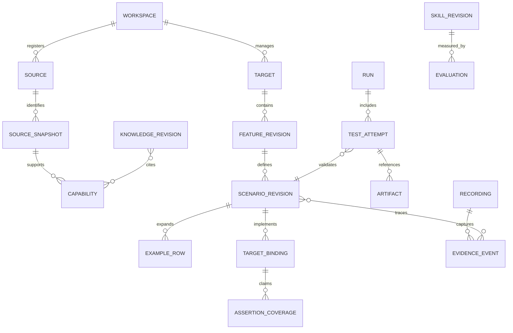

# Logical domain model

Planning model only. Create persistence tables, contracts and migrations when the approved phase needs them. IDs are opaque UUIDs; timestamps are UTC with display in the user's timezone. Revisions are immutable content snapshots, distinct from mutable indexes.

## Relationships

This is a logical view; join entities, constraints and indices are deliberately specified only as needed in migrations.

## Workspace and source entities

| Entity         | Core attributes and invariant                                                                                                                                                               | First needed       |
| -------------- | ------------------------------------------------------------------------------------------------------------------------------------------------------------------------------------------- | ------------------ |
| Workspace      | name, private state location, schema version; single local owner                                                                                                                            | P1                 |
| Source         | workspace, display name, canonical root, kind (`frontend/backend/shared/other`), enabled/index flags, include/exclude policy, preferred ref, detected framework metadata; read-only default | P1                 |
| Target         | workspace, canonical root, import/initialized origin, framework root mappings, manifest version, trust grant; no overlap with platform or context roots                                     | P1                 |
| Grant          | root ID, operation, scope, approval source, expiry/revocation; registration is not a generic shell grant                                                                                    | P1                 |
| SourceSnapshot | source, Git commit/ref when available, dirty flag, file-set/config hashes, capture time; non-Git uses content identity                                                                      | P3                 |
| IndexedFile    | snapshot, relative path, hash, size, extractor version, parse status; removed paths invalidate capabilities                                                                                 | P3                 |
| Capability     | kind, stable symbol key, source snapshot, file/line evidence, signature, confidence; language adapters report unresolved facts                                                              | P3 basic; P5 graph |
| CapabilityEdge | typed relationship (`uses`, `implements`, `depends_on`, `prepares_data_for`), endpoints, evidence and revision; inference labeled                                                           | P5                 |

Store detected language/framework as a list with evidence, not one mandatory label. Distinguish a Git logical ref from the actually indexed tree. Private absolute paths are server-owned data; API access is by root ID plus normalized relative path.

## Functional contract entities

| Entity                     | Core attributes and invariant                                                                                                                              |
| -------------------------- | ---------------------------------------------------------------------------------------------------------------------------------------------------------- |
| Feature identity/revision  | stable feature ID, target, path, Gherkin dialect, exact source hash/text snapshot, tags, Background/Rule structure; committed target file is authoritative |
| Scenario identity/revision | stable scenario ID, feature revision, source span, title, scenario/outline kind, step IDs, approval state and content hash                                 |
| Step                       | keyword/type, business text, data table/docstring, source span; no required browser/API operation in the canonical model                                   |
| Examples block/row         | block ID, row ID, header schema, ordered string cells, source span and revision; duplicate values still have separate identities                           |
| EvidenceLink               | scenario/step/requirement revision, recording event/transcript span or manual source, provenance kind and reviewer decision                                |
| TargetBinding              | scenario revision, framework, relative implementation files, runner selector metadata, revision, supported coverage; multiple bindings allowed             |
| AssertionCoverage          | requirement/assertion ID, observable property, target binding, coverage kind (`UI`, `API`, `HYBRID`), reason, validation evidence                          |
| Draft/proposal             | base revision, exact proposed text/files, hash, validation status, reviewer decisions; not an approved contract or target mutation                         |

Phase 1 supports manual text drafts, parser diagnostics, explicit saves and a minimal portable binding manifest for the demo. Phase 3 adds AI proposals and recording links; Phase 4 adds generated API mappings. The model does not imply automatic translation in Phase 1.

Reconciliation rules: keep IDs on ordinary edits; external ambiguous rename/split/merge or copied tags require explicit reconciliation. Never silently match by title alone. Parsing diagnostics block saving invalid contract revisions for execution, but drafts remain editable. A semantic edit invalidates old implementation coverage until reviewed/validated; old results retain their old revision.

## Execution entities

| Entity               | Fields and rules                                                                                                                                                                                      |
| -------------------- | ----------------------------------------------------------------------------------------------------------------------------------------------------------------------------------------------------- |
| Run                  | workspace/target, contract revision, selection snapshot, framework(s), environment reference, target Git revision and dirty-file hashes, toolchain versions, job ID, timestamps, infrastructure state |
| Job                  | kind, payload schema/version, lease, state, idempotency key, event sequence, cancel request; no arbitrary command text supplied by HTTP clients                                                       |
| TestAttempt          | runner-native ID, canonical scenario/row mapping if known, attempt number, status, duration, error classification, expected/actual references, native source location                                 |
| StepResult           | attempt, native/canonical step mapping, status, start/duration, failure and attachments; unavailable native details are `unknown`, not invented                                                       |
| Artifact             | run/recording/task owner, kind, relative store key, MIME, size, checksum, sensitivity, capture/redaction policy, retention/deletion status                                                            |
| ExecutionEnvironment | display name, allowlisted URLs and non-secret parameters, secret references, setup policy; credentials never copied into normalized reports                                                           |

An imported unlinked runner test remains visible with native identity and an explicit unmapped state; do not fabricate a canonical scenario. Exit code, missing report, malformed report, timeout and assertion failure are separate evidence. Retry attempts remain visible, with flakiness classification rather than hiding the first failure.

## Recording, agents and improvement entities

| Entity                      | Fields and rules                                                                                                                                                   | First needed                                        |
| --------------------------- | ------------------------------------------------------------------------------------------------------------------------------------------------------------------ | --------------------------------------------------- |
| Recording                   | session, initial URL/origin permission, browser/profile metadata, start/end, capture policy, completeness                                                          | P2                                                  |
| EvidenceEvent               | sequence, page/frame ID, event type, browser/receive time, calibrated session offset, uncertainty, observed payload, related artifacts and redactions              | P2                                                  |
| NarrationSegment            | audio chunk ID, time span, text, provider/version or manual origin, confidence, correction history; no inferred truth                                              | P2                                                  |
| AgentTask                   | workflow, input/base hashes, selected context, provider/model/reasoning settings, task events, status/cancellation, tool calls, usage and proposal references      | P3                                                  |
| ChangeProposal/Approval     | file diff hash, base hashes, authorized destination, validation results, reviewer/source/time, application/rejection state; approvals invalidated by changed bases | P3; earlier manual saves use equivalent file safety |
| Discovery/KnowledgeRevision | classification, claim, source hashes/revisions, confidence, lifecycle state, review and superseded-by; not all discoveries become durable                          | curated P0; engine P6                               |
| SkillRevision/Activation    | name, immutable bundle hash/version, proposal rationale, eval comparison, active pointer, approval and rollback reference                                          | policy P0; engine P6                                |
| EvaluationRun               | case-set version, model/config, context/toolchain hashes, measured/proxy metrics, raw evidence and acceptance verdict                                              | policy P0; engine P6                                |
| HealthFinding               | check/version, domain, severity, evidence, recommended action, fingerprint, first/last seen, resolution; stale findings remain traceable                           | readiness P1; full P6                               |

## Persistence and consistency

Use foreign keys, uniqueness constraints and explicit schema versions. Never hold SQLite transactions during filesystem walks, browser work, agent calls or JVM execution. The control process is the only metadata writer; WAL needs a verified patched engine and local storage. Index and run-result changes use bounded batches.

SQLite and the target filesystem do not share a transaction. File changes use a durable intent record, base-hash verification, temporary file plus same-directory atomic rename, and crash reconciliation. Multi-file changes need a journal and rollback material; never promise cross-file atomicity. Target writer leases prevent two platform writes, but external editor changes still require hash checks. Full source/target consistency under hostile concurrent filesystem mutation requires stronger OS isolation than an MVP path gateway.

Backups use SQLite's supported backup mechanism and a consistent manifest of immutable artifacts. Retention removes payloads under policy and marks missing/tombstoned references explicitly. No garbage collection may traverse user source roots or remove native target files.

## Phase 2 persisted projection

Schema version 2 adds `recordings` and ordered `recording_events` beside existing Phase 1 tables. Recordings retain policy, lifecycle/completeness, artifact hashes/expiry, sequenced audio acknowledgments and immutable manual transcript revisions. Events retain source/offset/uncertainty, session/receipt times, page/frame identity and bounded evidence. This projection supports actual capture only; scenario-evidence business links and AI/provider task tables remain unimplemented until their approved phases. See [ADR 0010](decisions/0010-recorder-evidence-and-privacy.md).
